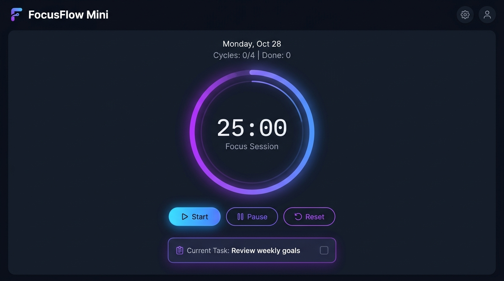
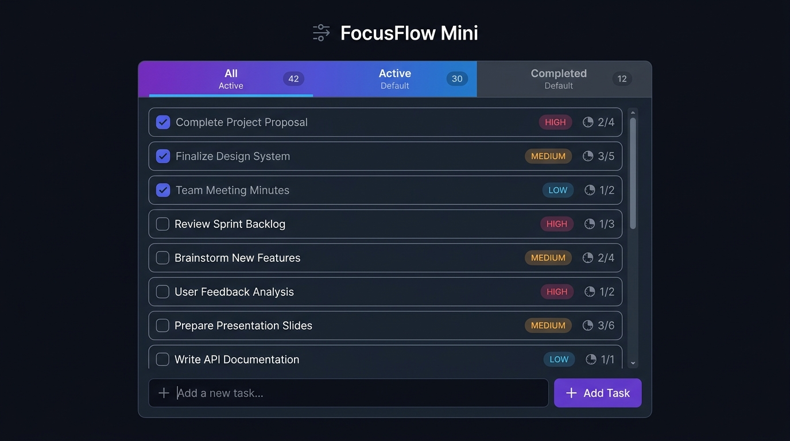
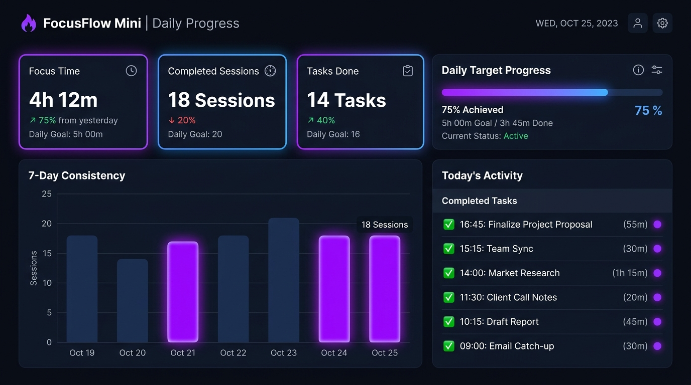
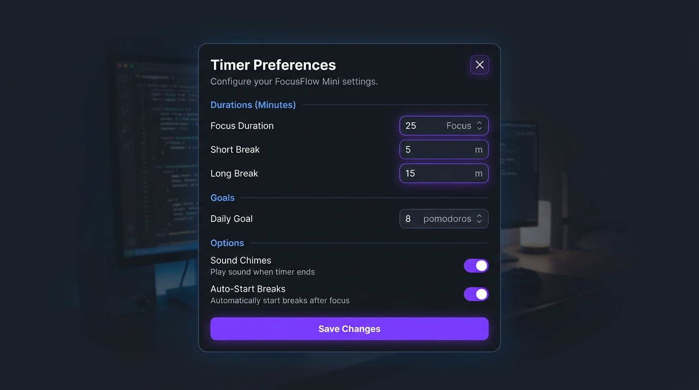

# FocusFlow Mini

FocusFlow Mini is a mobile-first productivity web application designed to help students and developers structure deep focus sessions, organize daily tasks, and track study progress consistently. Built with a clean, distraction-free dark aesthetic and tactile interactions, it brings the proven Pomodoro technique into a fast, lightweight, and responsive workflow.

**[Live Demo](https://focusflow-mini.vercel.app)** · **[GitHub Repository](https://github.com/dionstacey03-dev/focusflow-mini)**

---

## App Preview

### Pomodoro Timer Dashboard
The primary focus dashboard features an intuitive countdown ring, current session indicators, quick time adjustments, and an active task card to keep your attention anchored on what matters most.

<p align="center">
  
</p>

### Task Management
Organize your backlog with priority indicators (High, Medium, Low), target session estimates, and filter views for active and completed work.

<p align="center">
  
</p>

### Daily Progress & Consistency Tracker
Review daily productivity analytics including total focus hours, completed session milestones, and a 7-day consistency chart that highlights study streaks.

<p align="center">
  
</p>

### Timer Preferences & Settings
Tailor your sprint intervals, target session goals, audio chime alerts, and automatic break transitions to match your personal study rhythm.

<p align="center">
  
</p>

---

## Key Features

- **Pomodoro Focus Timer**: Dedicated focus sprints with a clear visual timer and quick controls (Start, Pause, Reset, Skip).
- **Short & Long Breaks**: Built-in 5-minute short breaks and 15-minute long rest sessions to prevent cognitive fatigue.
- **Task Management**: Create, prioritize, complete, and delete tasks with session estimation and direct timer integration.
- **Daily Productivity Statistics**: Real-time tracking of completed sessions, focus hours, and finished tasks.
- **Seven-Day Consistency Tracker**: Visual multi-day bar chart to monitor study habits and maintain focus momentum.
- **Customizable Timer Settings**: Configurable focus durations, break lengths, and daily Pomodoro targets.
- **Sound Alerts & Automation**: Ambient audio chimes on interval completion with optional auto-start break transitions.
- **Local Storage Persistence**: All tasks, daily history logs, and preferences are saved locally in the browser so progress is never lost.

---

## Technologies Used

- **React**: Modern functional component architecture with custom hooks for interval timing and local storage state.
- **Vite**: Ultra-fast frontend build tool and local development environment.
- **CSS**: Clean, mobile-first responsive layout with custom gradients and Tailwind utility styling.

---

## Getting Started

Follow these steps to run the project locally on your machine:

### 1. Clone the repository
```bash
git clone https://github.com/dionstacey03-dev/focusflow-mini.git
cd focusflow-mini
```

### 2. Install dependencies
```bash
npm install
```

### 3. Start the development server
```bash
npm run dev
```
Open your browser and navigate to `http://localhost:3000` (or the URL shown in your terminal).

### 4. Build for production
```bash
npm run build
```
The compiled, minified production assets will be output to the `dist` directory.

---

## Links

- **Live Application**: [https://focusflow-mini.vercel.app](https://focusflow-mini.vercel.app)
- **Source Code**: [https://github.com/dionstacey03-dev/focusflow-mini](https://github.com/dionstacey03-dev/focusflow-mini)
